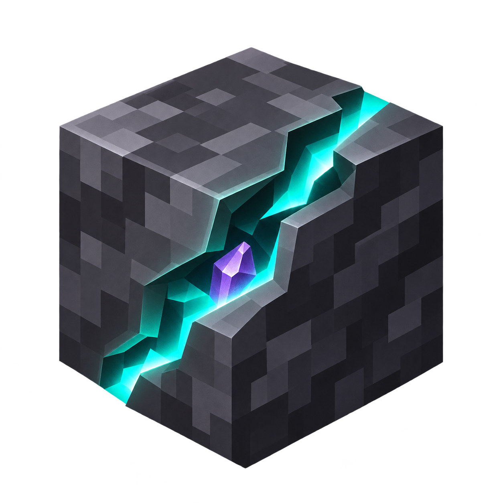

  
  <h1>riftDrop</h1>
  
Konfigurowalne dropy i poziomy górnictwa dla serwerów Minecraft.

  
<strong>1.1</strong> · Paper 1.21.x · Java 21

  

    <a href="docs/installation.md">Instalacja i aktualizacja</a> ·
    <a href="docs/configuration.md">Konfiguracja</a> ·
    <a href="docs/commands.md">Komendy i integracje</a> ·
    <a href="CHANGELOG.md">Changelog</a>
  

## Jak działa riftDrop

Gracze mogą zdobywać dodatkowe przedmioty i punkty za kopanie kamienia, granitu, diorytu, andezytu i deepslate. Każdy drop ma własną szansę, zakres wysokości Y i wymagany poziom. Menu `/drop` pokazuje szanse oraz statystyki i pozwala wybrać, które nagrody odbierać.

- **Progresja górnictwa** z poziomami, odblokowywaniem nagród i komendą `/level`.
- **TurboDrop i TurboExp** dla całego serwera albo wybranego gracza.
- **SQLite lub MySQL** do zapisu profili. SQLite działa od pierwszego uruchomienia.
- **PlaceholderAPI** do wyświetlania poziomu, punktów i rankingu w innych pluginach.

## Szybki start

1. Umieść `riftDrop-1.1.jar` w folderze `plugins/` na serwerze Paper 1.21.x uruchomionym na Javie 21.
2. Uruchom serwer. Dostosuj `config.yml`, `drops.yml` i `gui.yml` w `plugins/riftDrop/`.
3. Użyj `/adrop reload`, aby zastosować ustawienia gry. Zmiana ustawień bazy wymaga restartu.

Aktualizujesz DropPlugin 1.0.0? Zatrzymaj serwer i wymień stary JAR. riftDrop skopiuje dane ze starego katalogu, jeśli katalog docelowy jest pusty. Szczegóły i procedura wycofania aktualizacji są w [instrukcji migracji](docs/installation.md#aktualizacja-z-dropplugin-100).

## Dokumentacja

| Temat | Przewodnik |
| --- | --- |
| Wymagania, migracja, kopia danych i diagnostyka | [Instalacja i utrzymanie](docs/installation.md) |
| Szanse, XP, Fortune, poziomy i menu | [Konfiguracja](docs/configuration.md) |
| Permisje, komendy, Turbo i PlaceholderAPI | [Komendy i integracje](docs/commands.md) |
| Budowanie, testy i architektura | [Dokumentacja deweloperska](docs/development.md) |

Następny planowany cel zgodności to **Paper 26.3 na Javie 25**.
